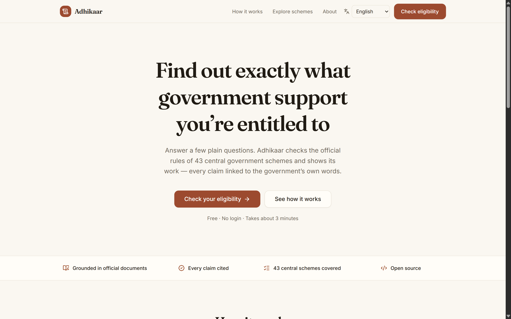
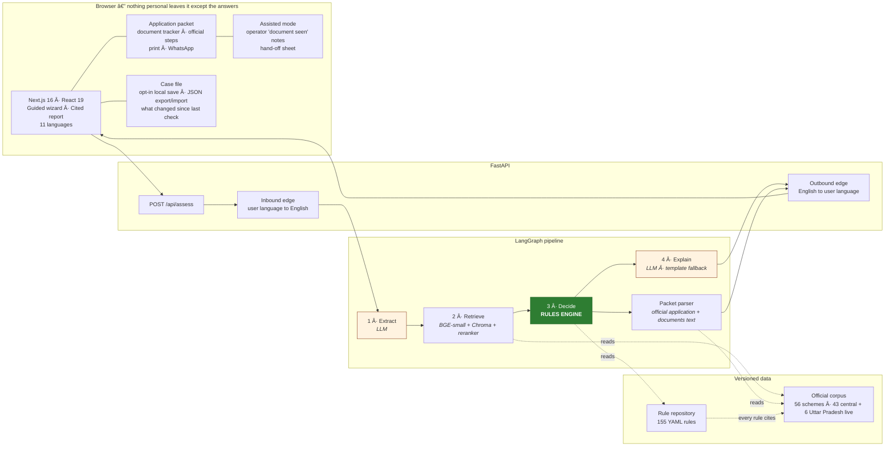
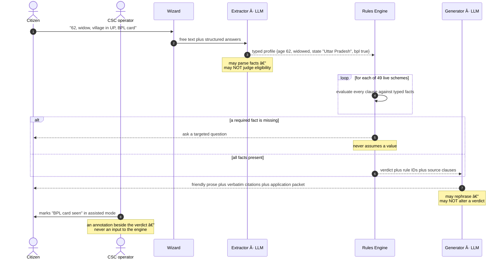
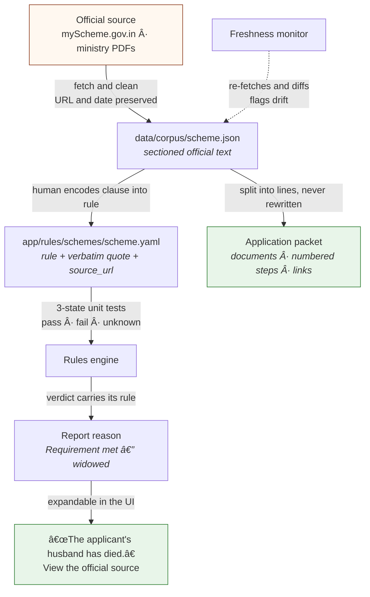
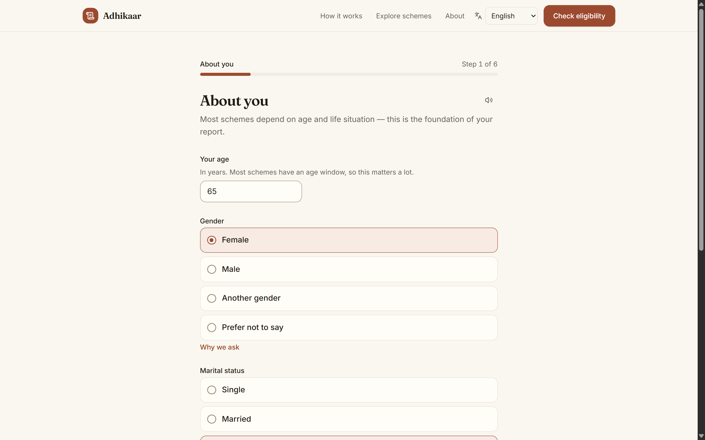
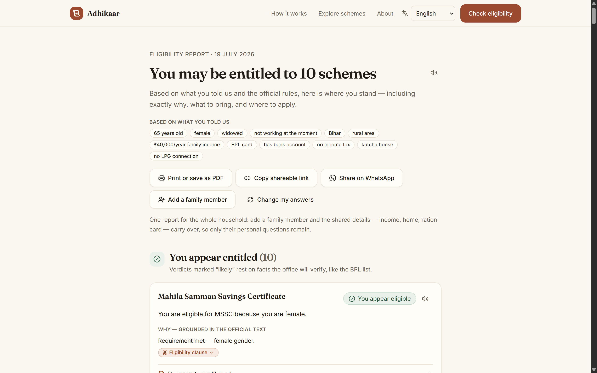
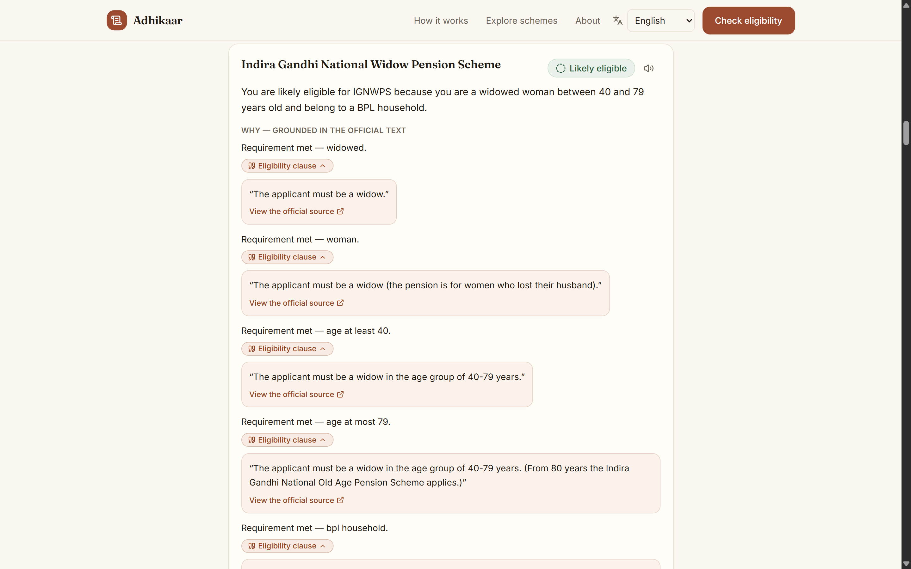
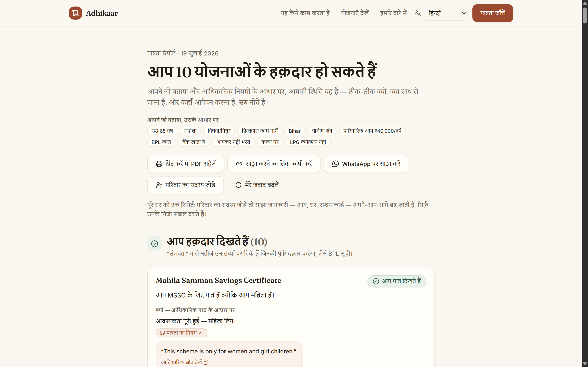
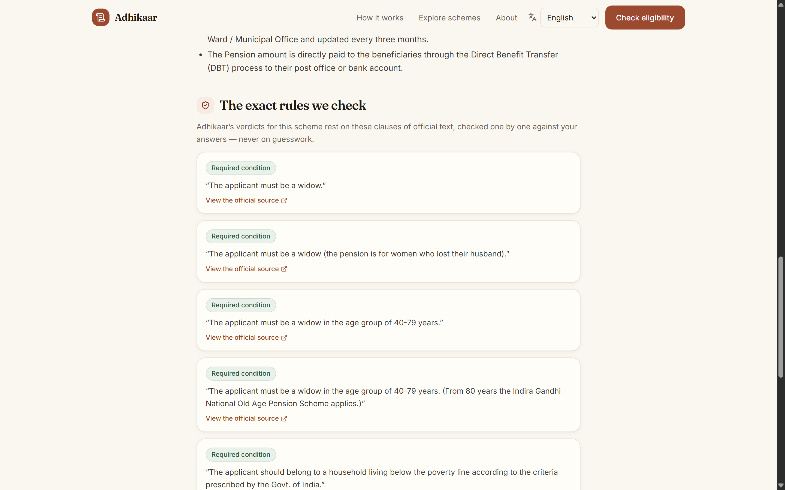
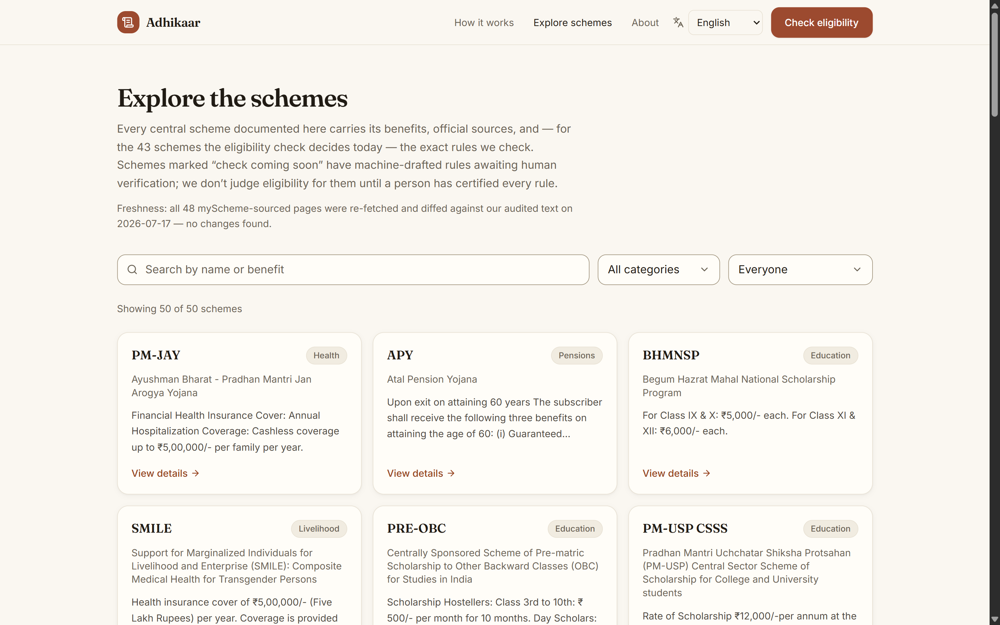

<div align="center">

# अधिकार · Adhikaar

**A verifiable public-benefit navigator for Indian welfare schemes.**

*Describe your situation in plain language. Get back every scheme you're entitled to, the government's own words as proof, and a packet to take to the office.*

[](#coverage)
[](#rules-as-code)
[](#quickstart)
[](#results)
[](#multilingual-by-construction)
[](#stack)
[](#stack)

</div>



---

## The problem

India runs hundreds of welfare schemes. Most people who qualify never claim them — not because the information is secret, but because it is scattered across PDFs, portals, and legalese, and because eligibility hinges on age, income, occupation, location, education, family composition and existing benefits all at once. A widow in a village in Uttar Pradesh has no realistic way to know she qualifies for a central pension *and* a state one — or which documents each office will ask for.

The obvious fix is an LLM chatbot over scheme documents. **That fix is dangerous.**

Retrieval-augmented LLMs cite real documents and still reason wrongly about eligibility — thresholds, age windows, exclusion clauses. During this project's own baseline run, the LLM judged a **62-year-old eligible for PMJJBY** — a scheme with an explicit **18–50 enrollment window that was sitting in its context.**

For a civic tool, a hallucinated entitlement is the worst possible failure: it promises money the law does not grant, and sends someone on a bus to a government office to be turned away.

> ### Core principle
> **Adhikaar never invents an entitlement.** Eligibility is decided by a deterministic, unit-tested rules engine in which every rule links to its source clause in an official government document. The LLM only (a) turns messy prose into structured facts and (b) phrases the verdict kindly. **It never decides** — not a verdict, not a document, not an application step. When a needed fact is missing, the system asks instead of guessing.

Adhikaar then goes past the verdict: for every scheme a person qualifies for, it prepares the application — the documents the official page lists, which ones they already hold, the official steps, and what to confirm at the office.

---

## Architecture

### 1 · System overview

The LLM sits at the *edges* of the system — parsing input and phrasing output. The decision core is deterministic, and everything personal stays in the browser.



### 2 · The decision boundary

This is the whole thesis. Note what the LLM — and the human operator — are **structurally incapable** of doing.



### 3 · Provenance chain

Every sentence in a report — and every line of an application packet — traces back to a government document. Grounding holds **by construction**, not by post-hoc checking.



---

## Evaluation

The system is built as a controlled experiment with **exactly one variable**: who decides eligibility.

|  | LLM-only baseline | Rules-as-code *(shipped)* |
| --- | --- | --- |
| Facts from user text | LLM | LLM |
| Retrieval over official text | BGE-small + Chroma | BGE-small + Chroma |
| **Eligibility decision** | **LLM judgment** | **Deterministic rules engine** |
| Verification | claim/quote containment | grounded by construction |
| Explanation | LLM | LLM *(cannot alter verdicts)* |

### Results

**2026-09-27 · rules engine · 52 labeled cases · 111 judged (profile, scheme) pairs**

| Metric | Central schemes *(41 cases)* | Uttar Pradesh schemes *(11 cases)* | All |
| --- | ---: | ---: | ---: |
| Judged pairs | 92 | 19 | **111** |
| Eligibility accuracy | 96.7% | 100% | **97.3%** |
| **False positives** *(entitlement promised that is not owed)* | 0 | 0 | **0** |
| **False negatives** *(entitlement missed)* | 0 | 0 | **0** |
| Declined to judge *(asked for a missing fact)* | 3 | 0 | 3 |
| Faithfulness *(claims supported by the cited official text)* | 72.6% | 73.3% | 72.8% |
| Retrieval precision / recall | 0.110 / 0.477 | 0.163 / 0.803 | — |

The Uttar Pradesh cases were labeled from the official clauses before the engine was run on them: eligible, not-eligible and need-more-information outcomes for each of the six state schemes, plus a Bihar resident as an out-of-state control (the UP schemes must not appear). Facts were extracted from free text by `openai/gpt-oss-20b` for the central cases and `qwen/qwen3.8-27b` for the Uttar Pradesh cases (the first model's daily free-tier limit ran out mid-run); faithfulness was judged by `qwen/qwen3.8-27b`. Summaries were fixed templates — they are not scored and cannot affect a verdict.

Retrieval only decides which *need-more-information* schemes are worth showing; verdicts never depend on it. Its recall on the central cases is lower than in earlier runs, whose facts were extracted by a different model family — the query is built from the extracted profile — and is under investigation rather than tuned against this set.

**The controlled comparison** (2026-07-13, 41 cases, 92 pairs, same retriever and generator for both phases): the LLM-only baseline scored 56.5% with **16 false entitlements** and 15 missed ones; the rules engine scored 91.3% with **0 and 0**. The rules engine has asserted zero false entitlements in every run since.

Reproduce (all LLM calls are disk-cached):

```bash
cd backend
PRIMARY_LLM=groq GROQ_MODEL=openai/gpt-oss-120b GROQ_JUDGE_MODEL=qwen/qwen3.8-27b \
  uv run python -m evals.run_eval --phase rules
```

Raw run artifacts live in `backend/evals/results/`.

---

## What it looks like

### Guided wizard — six steps, no login

Questions appear only when they matter: a person in Uttar Pradesh is also asked about other government pensions and the number of children, because the state's pensions and Kanya Sumangala Yojana depend on them. Three one-click demo profiles open a full report without answering anything.



### The report — verdict, reasoning, and an application packet for every scheme you qualify for

Each eligible or likely-eligible scheme opens an **application packet**:

- a generic applicant worksheet, filled from the check where the answer is known and left blank where it isn't — clearly labelled as a worksheet, not the scheme's form;
- the documents **the official page lists**, to tick off as you gather them — with where to get each missing one, how long it takes and what it costs; if the page lists none, the packet says so instead of guessing;
- the official application steps, numbered, split by online portal and offline office, with the official links — the source text is rendered as written, never paraphrased;
- a "before you go" list for conditional verdicts: exactly which self-declared facts the office will verify, and with what proof;
- print-ready packet and a one-tap WhatsApp summary.

Across all your schemes, missing documents are **ranked by how many schemes each one unlocks** — "income certificate: needed for 3 of your schemes".



### Every claim expands into the government's own words

This is the feature the whole architecture exists to make possible.



### Assisted mode — a person in the loop

At a CSC or Jan Seva Kendra, an operator switches on assisted mode. For each self-declared fact behind a *likely eligible* verdict they can mark **document seen** (with a short note). That appears as a separate "Verified by operator" badge and on a printed **hand-off sheet** — facts confirmed, documents still missing, and the scheme's own offline steps. **The verdict never changes**: it is the rules engine's alone, and a test pins that.

### Case file — pick up where you left off

A check can be kept as a case: answers, document ticks and operator notes. Saving on the device is opt-in and never automatic in assisted mode; a case moves between a phone and a CSC computer as a JSON file, validated strictly on import. Re-checking a saved case shows **what changed since last time** — schemes newly within reach, verdicts that flipped. A case holds no name or ID number, and nothing about it is stored on the server.

### Multilingual by construction

Prose is translated at the API edges. **Verdicts, amounts, scheme names, and official quotes are language-invariant** — notice the citation stays in its original official English while everything around it is Hindi.



### Scheme explorer — the rules are public, not a black box

Every scheme page publishes the exact rules the check applies, each with its quoted clause. The catalog filters by central or state scheme; Uttar Pradesh schemes carry a "State scheme — Uttar Pradesh" badge.





---

## Key design decisions

### Rules as code

Eligibility lives in versioned YAML — not in prompts, and not in Python branches:

```yaml
# app/rules/schemes/wpup.yaml (excerpt)
- id: family-income-cap-200k
  kind: require
  when: { field: annual_family_income_inr, op: lte, value: 200000 }
  clause: The annual income of the applicant and her family from all sources should not exceed ₹ 2,00,000/-
  source_url: https://www.myscheme.gov.in/schemes/wpup
  ask: Is your family's total yearly income ₹2,00,000 or less?
  review_status: verified
```

Because rules are **data**, the system gets several properties for free: every verdict carries its citation, rules are unit-testable in isolation, the frontend publishes the exact logic it applies, and adding a scheme becomes an encoding task rather than an engineering one.

### Three-valued logic

Rules evaluate to **pass / fail / unknown** — never a guessed boolean. An `unknown` propagates into a targeted follow-up question instead of a silent assumption. This is why the report distinguishes *"you appear eligible"* from *"likely eligible — the office will verify your BPL status."*

### State schemes without a second engine

Uttar Pradesh schemes are ordinary rule files whose first rule is `state eq "Uttar Pradesh"` — a self-declared fact with a residence-proof hint. State names are canonicalised at the schema boundary ("UP", "U.P." → "Uttar Pradesh"; anything unrecognised → *not stated*), and a test keeps the backend's state list identical to the wizard's. A scheme for a state the person doesn't live in is left out of the report rather than shown as "not eligible", so the near-miss detector can never suggest moving state.

### Human sign-off gate

56 schemes are documented; **49** are decided by the check. Six have machine-drafted rules held behind a review gate and are visibly marked *"check coming soon"*; one is listed for reference only (its applicant is an institution). Every rule carries a `review_status`: machine-drafted rules live in `rules/proposed/`, which the engine never loads, and a person certifies each rule against its official clause — the sign-off checklist is generated from the YAML itself.

### Graceful failure

If both LLM providers are down, the rules-only path still returns every verdict, reason and application packet; the one-line summaries fall back to fixed templates and the report says *"explanations simplified"*. The guided wizard never needs an LLM to reach a verdict.

### Freshness monitoring

A scheduled job re-fetches every myScheme-sourced page and diffs it against the audited corpus text, surfacing a "last verified" date in the UI and flagging drift for re-review. Government pages change silently; a civic tool that does not notice is worse than no tool.

---

## Coverage

|  | Count |
| --- | ---: |
| Schemes documented in the catalog | **56** |
| Schemes the eligibility check decides | **49** — 43 central, 6 Uttar Pradesh |
| Rules encoded from official text | **155** |
| Rules certified by a person against their clause | **155** |
| Languages | **11** |
| Backend tests | **440** |
| Frontend unit tests | **22** |

Uttar Pradesh schemes: Old Age Pension, Widow Pension, Divyang Pension, Mukhyamantri Kanya Sumangala Yojana, Post-Matric Scholarship (OBC), and SC/ST Pre-Matric Scholarship.

Languages: English, हिन्दी, বাংলা, मराठी, తెలుగు, தமிழ், ગુજરાતી, ಕನ್ನಡ, മലയാളം, ਪੰਜਾਬੀ, ଓଡ଼ିଆ.

---

## Stack

| Layer | Choice | Why |
| --- | --- | --- |
| Frontend | Next.js 16 · React 19 · Tailwind v4 | Static prerendering; works on low-end phones |
| API | FastAPI · Pydantic v2 | Typed contracts, OpenAPI for free |
| Orchestration | LangGraph | Explicit node graph — the pipeline is inspectable, not implicit |
| Embeddings | BGE-small (ONNX) | CPU-only, no GPU bill |
| Vector store | Chroma | Built from the committed corpus; instant cold start |
| Reranker | MiniLM cross-encoder (ONNX) | Local, free, measurably better than BM25 fusion here |
| LLMs | Gemini 2.5 Flash, with Groq-hosted gpt-oss-120b as fallback and eval judge | Free tiers with automatic fallback routing; all calls disk-cached |
| Persistence | Browser only (localStorage, JSON case file) | No accounts, no database of people |

---

## Repository layout

```
backend/
  app/ingestion/    fetch -> clean -> chunk -> embed -> index (provenance preserved)
  app/retrieval/    dense sweep + cross-encoder rerank over the corpus
  app/rules/        rules engine, YAML rule repository, application-packet parser, document guides
  app/agent/        LangGraph pipeline: profile -> retrieve -> decide -> explain
  app/extraction/   LLM-assisted rule drafting + semantic audit (human-gated)
  app/i18n/         translation at the API edges
  app/llm/          disk-cached Gemini/Groq clients + fallback router
  app/api/          FastAPI (OpenAPI-documented)
  evals/            labeled dataset, metrics, faithfulness judge, runner
  tests/            every rule in 3 logic states + boundaries + pipeline
frontend/
  app/              wizard, report, scheme explorer, trust and explainer pages
  components/assess application packet, document priority, assisted mode, case file
  lib/              packet, assisted, case and verdict-diff logic (pure, node-tested)
data/corpus/        cleaned official text (committed, with fetch dates)
data/raw/           raw API responses and source PDFs (provenance)
dataset/            published eligibility-rules dataset bundle
```

---

## Quickstart

**Prerequisites:** Python 3.11+, Node 23.6+ (the frontend unit tests use Node's native TypeScript support), [uv](https://docs.astral.sh/uv/)

```bash
git clone https://github.com/Ansh-Goyal01/ADHIKAAR.git && cd ADHIKAAR

# 1 - Keys (both free tiers)
#     https://aistudio.google.com/apikey  |  https://console.groq.com/keys
cp .env.example .env        # add GEMINI_API_KEY and GROQ_API_KEY
                            # optional: GROQ_MODEL (fallback, default openai/gpt-oss-120b), PRIMARY_LLM=groq

# 2 - Backend
cd backend
uv sync
uv run python -m app.ingestion index      # builds the vector index from the committed corpus
uv run uvicorn app.api.main:app --port 8000

# 3 - Frontend (new terminal)
cd frontend
npm install
cp .env.example .env.local                # points at http://localhost:8000
npm run dev
```

Open <http://localhost:3000>, or pick a demo profile on the first wizard step.

Tests: `cd backend && uv run python -m pytest` and `cd frontend && npm test`.

Every rule is tested in all three logic states (pass / fail / unknown) plus boundary values — a 17-year-old and an 18-year-old must land on opposite sides of an 18-year threshold, and the suite says so explicitly.

---

## Deployment

**Backend.** The FastAPI app runs as a container or a Python serverless function; set `GEMINI_API_KEY` and `GROQ_API_KEY` as secrets. The Chroma index is built from the committed corpus at build time.

**Frontend to Vercel.** Set root directory to `frontend/` and `NEXT_PUBLIC_API_URL` to the backend URL. `NEXT_PUBLIC_*` values are baked at build time, so redeploy after changing them.

The API is rate-limited per client IP (10 req/min) and CORS-restricted.

---

## Limitations (honest ones)

- **One state so far.** Six Uttar Pradesh schemes are covered; no other state's schemes are. For anyone outside Uttar Pradesh, *"not eligible here" is not "not eligible anywhere."*
- **Self-reported facts.** BPL/SECC membership and state residence cannot be verified from a conversation, so such verdicts are explicitly conditional (*likely eligible*) and the packet lists the proof to carry. Operator annotations record what was seen; they do not change verdicts.
- **Simplified rules.** Some rarely-triggered criteria are not encoded — e.g. notified-crop areas (PMFBY), Kanya Sumangala's twins exception, the age-as-of-1-July reference date for the UP pre-matric scholarship. Every simplification is listed in its rule file, beside the rule it affects.
- **PMS-SC provenance.** The official guidelines PDF is a scan; its corpus text is a model transcription cross-checked against the department's pages.
- **Document lists depend on the official page.** 19 of the 56 corpus entries have no documents section upstream; their packets say so and point to the office instead of guessing.
- **Small eval set.** 52 cases / 111 pairs — these are counts, not significance claims.
- **Multilingual parity in progress.** Hindi is hand-reviewed; the other nine Indic languages are machine-translated and awaiting native-speaker review.
- **Not legal advice.** Final decisions always rest with the implementing authorities.

---

## Roadmap

- More states, starting with the largest by population, through the same ingestion and sign-off pipeline
- Formal verification of the rule base (SMT) — prove no scheme has contradictory or unreachable clauses
- Offline-first PWA: compile rules to a client-side evaluator, verified for parity against the Python engine
- Public eligibility API and MCP server, so other assistants can call a verified engine instead of hallucinating entitlements
- Change detection that opens a pull request when an official clause changes

---

## License and data

Scheme text belongs to the **Government of India** and the **Government of Uttar Pradesh**, reproduced from public official sources with URLs and fetch dates preserved. No personal data is collected or stored server-side; the eligibility check requires no login, and anything kept — a resume code, a saved case, an exported case file — stays on the person's own device.

<div align="center">

**Sources:** [myScheme](https://www.myscheme.gov.in/) · ministry guidelines and gazette PDFs *(linked per scheme)*

*Built to be checkable. If a verdict looks wrong, every claim links to the text it came from — go read it.*

</div>

